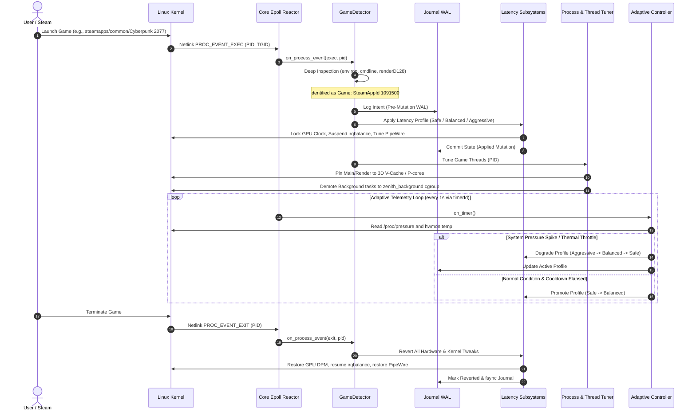
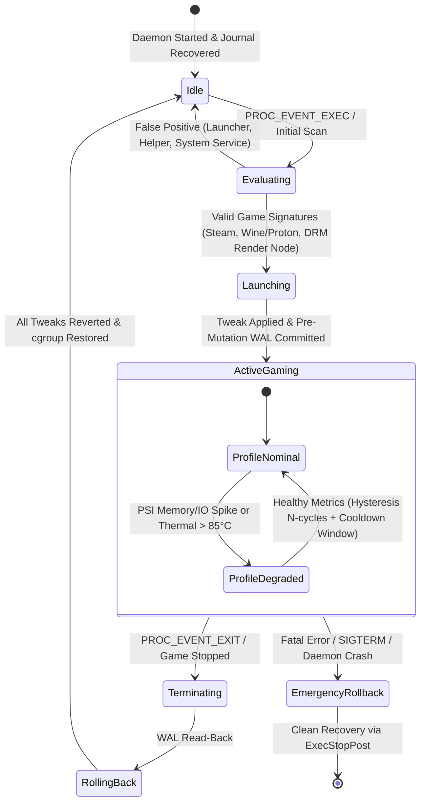

# Zenith Gaming Daemon: System Architecture & Design Specification

> **Target Standard**: Modern C++20 | Linux Kernel 6.6+ (CachyOS, Arch, SteamOS, Fedora)  
> **Status**: Reference Architecture Specification  
> **Security Baseline**: Zero-Trust Root Daemon, No Shell, No Raw Memory/Ptrace, Zero External Telemetry  

---

## 1. High-Level Architecture Overview

Zenith is a reactive, event-driven Linux daemon designed to minimize input-to-display latency, stabilize 1% low frame rates, and isolate system overhead while gaming. Zenith operates under strict root isolation, applying kernel, cgroup, scheduling, IRQ, audio, network, and GPU clock optimizations dynamically upon game detection, and rolling them back atomically when the game exits.

```mermaid
graph TD
    subgraph Kernel Space
        NetlinkProc[Netlink Proc Connector<br/>PROC_EVENT_EXEC/EXIT]
        PSI[PSI Pressure Counters<br/>/proc/pressure/{cpu,io,mem}]
        Sysfs[Sysfs & Procfs<br/>/sys/devices, /proc/sys]
        CgroupV2[cgroup v2 Hierarchy<br/>/sys/fs/cgroup/zenith_*]
        Hwmon[Hardware Sensors<br/>hwmon temp & throttle]
    end

    subgraph Zenith Core Daemon (Single-Threaded Reactor)
        Poller[Event Poller / Epoll Reactor<br/>Signalfd, Timerfd, Netlink, Sockets]
        GameDetector[Game Detector & Classifier<br/>Steam, Proton, Heroic, Lutris, Emulators]
        ProcessTuner[Process & Thread Tuner<br/>Main/Render/Audio/Shader Pinning]
        AdaptiveCtrl[Adaptive Closed-Loop Controller<br/>PSI Telemetry, Thermals, Hysteresis]
        TweakEngine[Tweak Engine & Subsystems<br/>CPU, GPU, IRQ, PipeWire, Net, cgroup]
        JournalWAL[WAL State Journal<br/>/run/zenith/journal.json]
    end

    subgraph Client & IPC
        Socket[UNIX Domain Socket<br/>/run/zenith/zenith.sock<br/>SO_PEERCRED 0660]
        ZenithCtl[zenithctl CLI Tool<br/>Status, Suggest, Manual Override]
        LocalDB[(Local SQLite/JSON DB<br/>/var/lib/zenith/learning_db.json)]
    end

    NetlinkProc -->|Events| Poller
    Poller -->|Dispatch| GameDetector
    PSI -->|Telemetry| AdaptiveCtrl
    Hwmon -->|Thermals| AdaptiveCtrl
    GameDetector -->|Game Active/Exit| TweakEngine
    GameDetector -->|PID Tasks| ProcessTuner
    AdaptiveCtrl -->|Degrade/Promote Profile| TweakEngine
    TweakEngine -->|Write-Ahead Log| JournalWAL
    TweakEngine -->|Apply/Revert| Sysfs
    TweakEngine -->|Isolate Background| CgroupV2
    ProcessTuner -->|Uclamp/Nice/Affinity| Sysfs
    Socket -->|Authorized IPC| Poller
    ZenithCtl -->|Query/Command| Socket
    AdaptiveCtrl -->|MangoHud Benchmark Data| LocalDB
```

---

## 2. Core Data Flow & Reactive Pipeline

Zenith avoids continuous CPU-heavy polling loops. Detection is primarily event-driven using Netlink process connector events (`PROC_EVENT_EXEC`, `PROC_EVENT_EXIT`), falling back to low-frequency scans only if the connector is unavailable.



---

## 3. Game Lifecycle State Machine

Zenith tracks each game through a strictly defined state machine with bounded transitions and anti-flutter debouncing.



---

## 4. Security, Isolation & Zero-Trust Architecture

Zenith operates as a hardened system daemon. It assumes untrusted local environments and strictly limits access surfaces.

```mermaid
flowchart TD
    subgraph Untrusted Space
        LocalUser[Local Non-Root User]
        MaliciousApp[Malicious Process / Spoofed comm]
        GameExecutable[Game Binary / Anti-Cheat Ring 3]
    end

    subgraph Hardened Boundary
        SocketCheck{SO_PEERCRED<br/>UID/GID Check}
        Whitelist[Execve Whitelist Filter<br/>Absolute Paths Only]
        OpenatSandbox[openat2 Sandboxing<br/>RESOLVE_BENEATH | RESOLVE_NO_SYMLINKS]
    end

    subgraph Zenith Execution Core
        CapabilityDrop[Dropped Capabilities<br/>Ambient cleared, PR_SET_NO_NEW_PRIVS]
        NoShell[Zero Shell Rule<br/>No system, popen, sh -c]
        MemoryShield[Non-Invasive Anti-Cheat Shield<br/>No ptrace, no mem reads, TracerPid=0]
    end

    LocalUser -->|UNIX Socket Connection| SocketCheck
    SocketCheck -->|Deny Non-Privileged| DropConn[Drop & Log Security Event]
    SocketCheck -->|Allow Wheel/Root/GameMode| SocketCmd[Accept Limited Command]

    MaliciousApp -.->|Attempt Symlink Attack| OpenatSandbox
    OpenatSandbox -->|EXDEV / ELOOP Trapped| RejectAccess[Block Write]

    ZenithExecutionCore --> Whitelist
    ZenithExecutionCore --> OpenatSandbox
    GameExecutable -.->|Monitored Non-Invasively| MemoryShield
```

### Key Security Principles:
1. **Zero Shell Policy**: Absolutely no `system()`, `popen()`, or shell string concatenations. Every external process is executed using `fork()` + `execve()` with validated string vector arguments and whitelisted absolute binaries.
2. **Virtual FS Sandboxing**: Sysfs and Procfs mutations use `openat2` with `RESOLVE_BENEATH` and `RESOLVE_NO_SYMLINKS` anchored to verified directory file descriptors (`dirfd`).
3. **No-New-Privileges & Capability Dropping**: Drops all unnecessary capabilities (`CAP_NET_ADMIN`, `CAP_SYS_PTRACE`, `CAP_SYS_RAWIO`), retaining strictly `CAP_SYS_NICE`, `CAP_SYS_ADMIN`, and `CAP_SYS_RESOURCE`.
4. **Anti-Cheat Non-Invasive Isolation**: Never attaches to game threads via `ptrace`, never reads `/proc/<pid>/mem`, never injects code or shared libraries. Maintains perfect compatibility with Easy Anti-Cheat (EAC), BattlEye, and VAC.

---

## 5. Memory Management & Monadic Error Handling

### 5.1 RAII & Resource Management
- **Zero Raw Allocation**: Zero occurrences of raw `new` and `delete`.
- **`UniqueFd`**: All operating system file descriptors are managed by a move-only `UniqueFd` wrapper that automatically closes descriptors upon scope exit (using `close()`).
- **`CgroupDirGuard`**: Manages cgroup directory lifetimes, removing directory nodes on destruction.
- **`TweakMutationGuard`**: Automatically executes rollback logic if an exception or early return occurs before explicit commit.

### 5.2 Monadic `Result<T, Error>`
Zenith utilizes a C++20 monadic `Result<T, Error>` type across all core subsystems:
```cpp
// Explicit error code with rich context
struct Error {
    ErrorCode code;
    std::string message;
    int system_errno{0};
    std::source_location location{std::source_location::current()};
};

template <typename T>
using Result = zenith::Result<T, Error>;
```
- Eliminates C++ exception overhead and non-deterministic stack unwinding on the latency-sensitive hot path.
- Provides functional chaining via `.and_then()`, `.or_else()`, and `.map()`.
